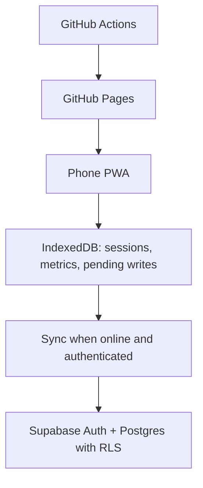

# LiftLog

An offline-first, mobile-first workout tracker for Monday, Wednesday and Friday training. Built with strict TypeScript, Vite, Chart.js, IndexedDB, Supabase and GitHub Pages.

## Architecture

## Local development

1. Install Node.js 22 or newer.
2. Run `npm install` then `npm run dev`.
3. Without Supabase credentials, the app shows a setup screen and does not allow logging.
4. Optional: copy `.env.example` to `.env.local` and fill in your Supabase project URL and publishable/anon key.
5. Run `npm run typecheck`, `npm run lint`, `npm test` and `npm run build` before committing.

## Cloud setup (required before recording workouts)

1. Create a **free** Supabase project. Choose **Europe (Stockholm)** if available in the region selector. No paid plan is needed.
2. In the Supabase SQL Editor, run `supabase/migrations/20261115000000_init.sql`. Alternatively, use the Supabase CLI migration workflow yourself.
3. Under Authentication > Providers, enable Email magic links. Under Authentication > URL Configuration, set site URL to `https://YOUR_USERNAME.github.io/liftlog/` and add the same address to redirect URLs.
4. The app lives in the public GitHub repository `Sura34/liftlog`. Code is public, workout records are not.
5. In GitHub repository Settings > Secrets and variables > Actions, create `VITE_SUPABASE_URL` and `VITE_SUPABASE_ANON_KEY` from your Supabase project URL and publishable/anon key. These are client-visible by design. **Never use a Supabase service role or secret key in Vite variables.**
6. In Settings > Pages, select **GitHub Actions** as the deployment source. Push to `main` or manually run Deploy Pages. Visit `https://YOUR_USERNAME.github.io/liftlog/`.
7. Open the deployed app, enter your email and follow the magic link. Add the PWA to your phone home screen using your browser menu.

## Data and privacy

- Sessions and body measurements are saved in IndexedDB before cloud sync. A pending queue retries writes on reconnection.
- Every private Supabase table has user-scoped Row Level Security. Public exercise catalog tables are read-only to clients.
- Login is required to access workout data. Local IndexedDB is separated by user ID and erased on sign-out. Offline writes are queued and synced after reconnecting. IndexedDB is not encrypted: use a device screen lock. Export JSON before clearing browser data.
- Supabase free projects may pause after roughly one week of inactivity. Resume the project in the Supabase dashboard; local offline logging still works while paused.
- GitHub Pages and Supabase have usage limits. Monitor them; do not enable paid upgrades without deciding to do so.

## Current limitations

- The figure on each exercise card is an animated stylized illustration, not a validated anatomical movement demonstration. Use Watch demo to see real form demonstrations.
- This is an initial release. There is no conflict-resolution UI for simultaneous offline edits from multiple devices. Avoid logging the same session on two devices at once.
- Week numbering currently uses a fixed cycle anchor date in `src/main.ts`; make it configurable for long-term use.
- Supabase's catalog tables are seeded for future editing, while the client currently ships the same program in TypeScript for reliable offline access.