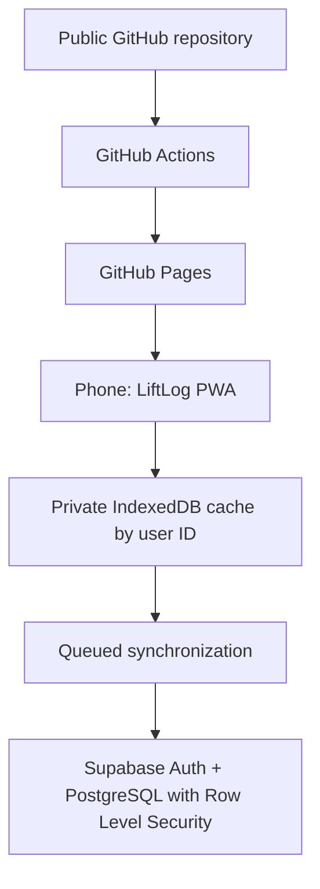

# LiftLog

**Train. Track. Progress.** A professional, mobile-first personal strength training PWA for any time of day.

**Repository:** https://github.com/Sura34/liftlog

**Intended website:** https://sura34.github.io/liftlog/

## What it does

- Choose workout A, B, or C whenever you want. Monday, Wednesday and Friday are convenient defaults, not enforced restrictions.
- Record kilograms and repetitions or distance for each set, with previous performance shown as placeholders.
- Progressive overload suggestions, rest timer, form cues and video-search links for every exercise.
- Private workout history, estimated 1RM/volume/top-weight charts, bodyweight and waist tracking, weekly targets, CSV/JSON export and JSON import.
- Installable PWA, draft autosave, account-scoped IndexedDB cache and queued writes while offline.
- Responsive dark interface.

## Architecture

## Set up free Supabase (required)

**Until these steps are complete, the deployed app shows a setup screen and does not accept personal workout data.**

1. Create a project at https://supabase.com/dashboard on the **Free** plan. Select Stockholm or the closest EU region available. Do not enable paid upgrades.
2. Open **SQL Editor** for that project. Copy and run the complete migration at [supabase/migrations/20261115000000_init.sql](supabase/migrations/20261115000000_init.sql). It creates the exercise catalog, workout/session/sets/measurements tables and enables owner-only row-level security for private data.
3. In **Authentication > Providers > Email**, enable email sign-in via one-time code/magic link. Keep signup limited if this app is just for you. Consider turning off open signup and creating your own account through the dashboard if you do not want other people to register.
4. In **Authentication > URL Configuration**, set **Site URL** to `https://sura34.github.io/liftlog/` and add `https://sura34.github.io/liftlog/` to the allowed redirect URLs.
5. In Supabase **Project Settings > API**, copy **Project URL** and the **publishable key** (or the older `anon` key). **Never use a secret or service_role key in a browser app.**
6. In [GitHub Actions secrets settings](https://github.com/Sura34/liftlog/settings/secrets/actions), add two repository secrets:
    - `VITE_SUPABASE_URL`: the Supabase Project URL
    - `VITE_SUPABASE_ANON_KEY`: the Supabase publishable or anon key
7. In [GitHub Pages settings](https://github.com/Sura34/liftlog/settings/pages), choose **GitHub Actions** as the deployment source. Open [Actions](https://github.com/Sura34/liftlog/actions) and run **Deploy LiftLog**, or push any new commit to `main`.
8. Visit https://sura34.github.io/liftlog/, enter your email and open the magic link sent by Supabase. On your Android browser, choose **Add to Home screen** or **Install app**.

The public client configuration is generated during deployment in `config.js`. It does **not** contain a confidential key. Access protection comes from Supabase authentication and server-side RLS policies, not hiding the public anon/publishable key.

## Privacy model

- The GitHub repository contains only source code and a public exercise catalog. It does **not** contain your logged workouts.
- All database tables storing personal workouts and measurements require authentication, with RLS enforcing `user_id = auth.uid()`. No account can query or modify another account's private rows through the client API.
- Login is required to view or log personal data. Locally cached sessions are separated by Supabase user ID and erased when you sign out. Offline access depends on having a valid session already saved on that browser.
- **Not encrypted at rest in the browser:** anyone with access to an unlocked device or developer tools may read the cache, so use a device screen lock. An incognito window does not retain offline history.
- The app warns about unsynced data before sign-out. Export JSON periodically as a backup. Avoid recording the same session on two devices simultaneously because conflict resolution is not implemented yet.
- Supabase free projects may pause after inactivity. Resume them from the dashboard; no paid upgrade should be necessary for normal personal use.
- Anyone can see the public source, but only accounts authenticated to Supabase can access their own workout data. Disabling open signup is recommended for a personal-only app.

## Tech and deployment

This edition is **vanilla JavaScript + CSS + HTML + IndexedDB + Supabase JS**. There is no npm build stage or server to pay for. GitHub Actions deploys the static site directly to GitHub Pages. The Supabase client SDK is delivered from a public CDN and cached for subsequent offline loads. The JS source can be checked with `node --check app.js`.

## Limitations and planned improvements

- Exercise figures are stylized SVG illustrations, **not real exercise demonstration photos or anatomically accurate movement animations**. Use the provided "Watch demo" YouTube search links for form.
- The 9-week cycle uses your first completed session as its approximate starting point and resets after the deload. For precise programming, configure a formal start date later.
- Live deployment, email login and database access require completing the Supabase and GitHub Pages setup above.
- Free tiers have quotas and availability limits. No paid service is configured.
