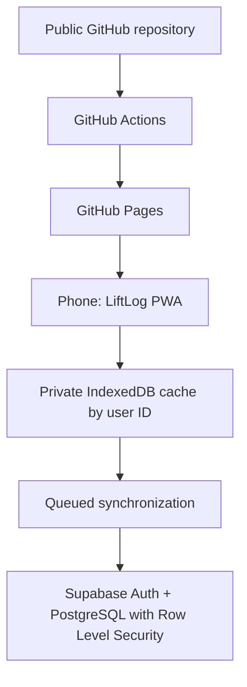

# LiftLog

**Train. Track. Progress.** A professional, mobile-first personal strength training PWA for any time of day.

**Repository:** https://github.com/Sura34/liftlog

**Intended website:** https://sura34.github.io/liftlog/

## What it does

- Choose workout A, B, or C whenever you want. Monday, Wednesday and Friday are convenient defaults, not enforced restrictions.
- Record kilograms and repetitions or distance for each set, with previous performance shown as placeholders.
- Progressive overload suggestions, rest timer, form cues and video-search links for every exercise.
- Private workout history, estimated 1RM/volume/top-weight charts, bodyweight and waist tracking, weekly targets, CSV/JSON export and JSON import.
- Installable PWA, draft autosave, account-scoped IndexedDB cache and queued writes while offline.
- Responsive dark interface.

## Architecture

## Set up free Supabase (required)

**Until these steps are complete, the deployed app shows a setup screen and does not accept personal workout data.**

1. **Completed:** The `liftlog` project already exists on the **Free** plan in Stockholm (`eu-north-1`), project ID `xdkpimpjsrikgeczoikd`. No paid upgrades are enabled.
2. **Completed:** The migration at [supabase/migrations/20261115000000_init.sql](supabase/migrations/20261115000000_init.sql) was applied, including the exercise catalog and owner-only RLS. Supabase security advisors reported no issues at initial setup.
3. In **Authentication > Providers > Email**, enable email sign-in via one-time code/magic link. Keep signup limited if this app is just for you. Consider turning off open signup and creating your own account through the dashboard if you do not want other people to register.
4. In **Authentication > URL Configuration**, set **Site URL** to `https://sura34.github.io/liftlog/` and add `https://sura34.github.io/liftlog/` to the allowed redirect URLs.
5. **Completed:** The app uses the Supabase **publishable** key. **Never use a secret or service_role key in a browser app.**
6. The free Supabase project is already created and its **public publishable key** and URL are committed in `config.js`. No GitHub Actions secrets are required for this public browser configuration. You may optionally override them with repository secrets `VITE_SUPABASE_URL` and `VITE_SUPABASE_ANON_KEY`. Never add service-role or secret keys.
7. In [GitHub Pages settings](https://github.com/Sura34/liftlog/settings/pages), choose **GitHub Actions** as the deployment source. Open [Actions](https://github.com/Sura34/liftlog/actions) and run **Deploy LiftLog**, or push any new commit to `main`.
8. Visit https://sura34.github.io/liftlog/, enter your email and open the magic link sent by Supabase. On your Android browser, choose **Add to Home screen** or **Install app**.

The public client configuration is loaded from committed `config.js` unless GitHub repository secrets override it during deployment. It does **not** contain a confidential key. Access protection comes from Supabase authentication and server-side RLS policies, not hiding the public anon/publishable key.

## Privacy model

- The GitHub repository contains only source code and a public exercise catalog. It does **not** contain your logged workouts.
- All database tables storing personal workouts and measurements require authentication, with RLS enforcing `user_id = auth.uid()`. No account can query or modify another account's private rows through the client API.
- Login is required to view or log personal data. Locally cached sessions are separated by Supabase user ID and erased when you sign out. Offline access depends on having a valid session already saved on that browser.
- **Not encrypted at rest in the browser:** anyone with access to an unlocked device or developer tools may read the cache, so use a device screen lock. An incognito window does not retain offline history.
- The app warns about unsynced data before sign-out. Export JSON periodically as a backup. Avoid recording the same session on two devices simultaneously because conflict resolution is not implemented yet.
- Supabase free projects may pause after inactivity. Resume them from the dashboard; no paid upgrade should be necessary for normal personal use.
- **Owner-only data access is now enforced by RLS:** personal workout data can be accessed only by the existing approved Supabase account (`suramiheret@gmail.com`, identified by its Supabase user UUID). The browser also rejects other email addresses and requests `shouldCreateUser: false` for magic-link login.
- Other addresses may still create a Supabase Auth account if **Allow new users to sign up** remains enabled on the project's Auth settings. However, these accounts cannot read or write the owner's training data. To prevent new accounts entirely, disable that setting in the Supabase dashboard **after confirming the owner account works**.

## Muscle-growth program (three flexible training days)

The default A/B/C program is designed for consistent hypertrophy training with about 16–17 working sets per session. These are **working sets**, not warm-ups.

| Day | Theme | Main exercises | Working sets |
| --- | --- | --- | --- |
| A | Squat and push | Back squat, dumbbell bench, seated row, RDL, lateral raise, triceps pushdown | 16 |
| B | Pull and legs | Lat pulldown, leg press, dumbbell bench, shoulder press, seated leg curl, biceps curl, face pull | 17 |
| C | Hinge and upper body | Trap-bar deadlift, incline press, one-arm row, walking lunges, hip thrust, lateral raise, overhead triceps extension | 16 |

- Perform most working sets with about **1–2 repetitions in reserve**, controlling the weight and prioritizing correct form.
- When every set of an exercise reaches the **top** of its rep range cleanly, increase the weight by the smallest available increment next time. Otherwise, aim to complete one more repetition.
- Rest about **2–3 minutes for demanding compound lifts** and **60–90 seconds for accessories**; keep supersets to exercises marked a/b.
- **Week 9 is a reduced-volume deload**. The app no longer automatically adds unnecessary sets during weeks 5–8.
- Cardio finishers are now optional. A session may still exceed one hour depending on gym traffic, equipment and rest needs.
- Recovery matters: eating sufficient protein, adequate energy intake, and sleeping 7–9 hours consistently are part of the program. In a substantial calorie deficit muscle gain can be slower; prioritize a modest deficit or maintenance calories if gaining muscle while losing fat.
- This is a practical starting program, not a promise of a particular growth rate. Adjust volume based on recovery, progress and available time.

## Tech and deployment

This edition is **vanilla JavaScript + CSS + HTML + IndexedDB + Supabase JS**. There is no npm build stage or server to pay for. GitHub Actions deploys the static site directly to GitHub Pages. The Supabase client SDK is delivered from a public CDN and cached for subsequent offline loads. The JS source can be checked with `node --check app.js`.

## Limitations and planned improvements

- Exercise cards now show verified **start and finish photos** for all 19 exercise types, with an expanded movement guide and three form cues. These are two-position still demonstrations, not a continuous motion video. Some named variations have explanatory notes; use the provided "Watch demo" video-search links if unsure about technique.
- Demonstration images are served from the public-domain [free-exercise-db](https://github.com/yuhonas/free-exercise-db) repository. Images are cached for subsequent offline viewing after they have been loaded. The app has no paid image services.
- The 9-week cycle uses your first completed session as its approximate starting point and resets after the deload. For precise programming, configure a formal start date later.
- Live deployment, email login and database access require completing the Supabase and GitHub Pages setup above.
- Free tiers have quotas and availability limits. No paid service is configured.
